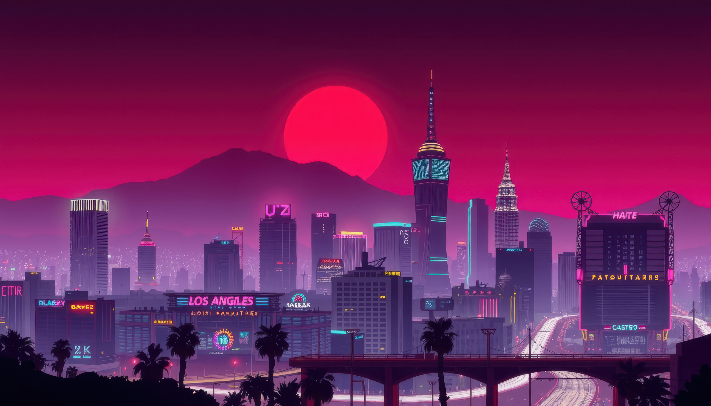
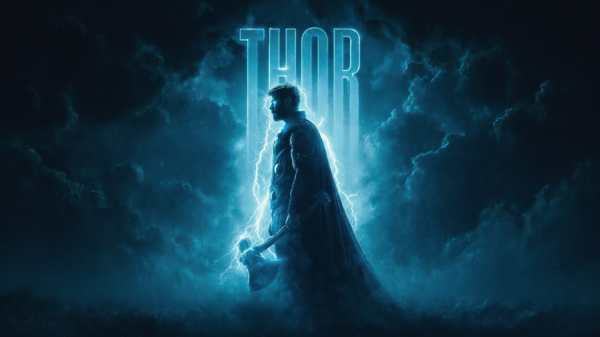
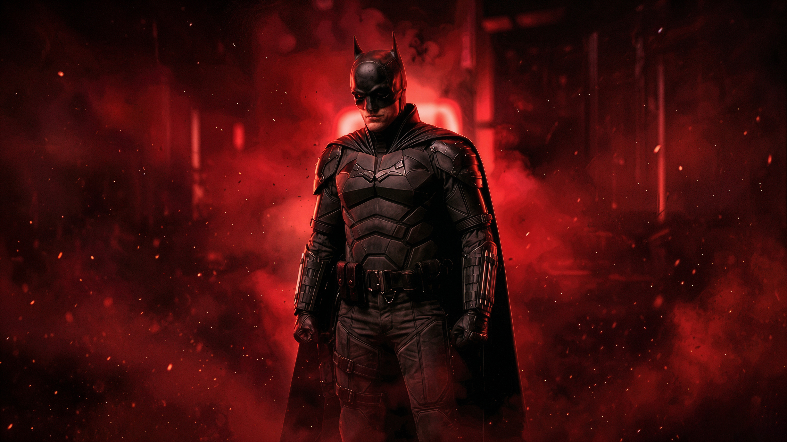
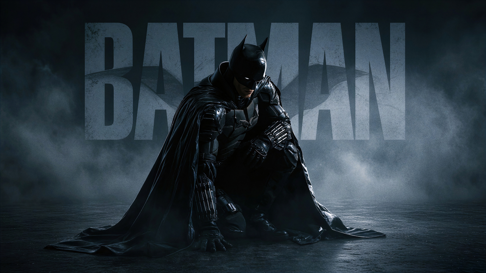

# Wallpapers

Four original-resolution JPEGs. Editing-history metadata has been removed for privacy; image pixels are unchanged. No resizing or JPEG recompression. See [asset notices](../ASSETS.md) for the separate rights status; these are not covered by the code's MIT license.

| Neon city | Thor |
| --- | --- |
|  |  |

| Batman · red | Batman · blue |
| --- | --- |
|  |  |

The README browser may scale the previews, but the linked files retain the original image quality. Verify downloads with `sha256sum -c SHA256SUMS` (Linux) or `shasum -a 256 -c SHA256SUMS` (macOS), from this directory.
